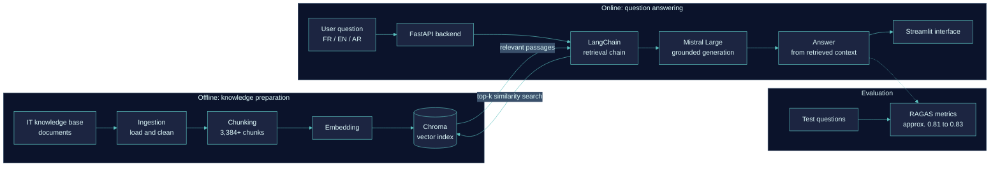
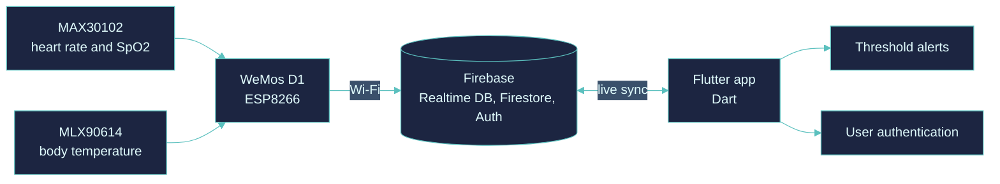
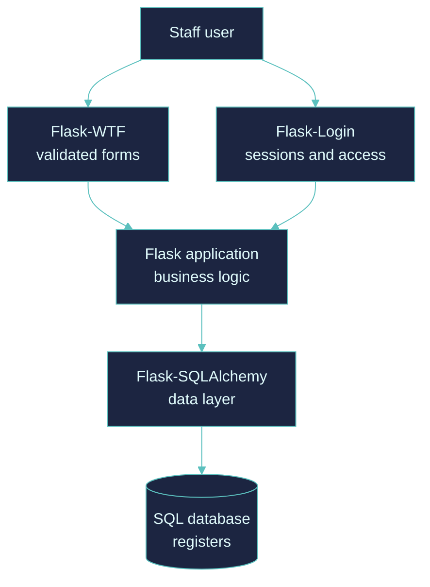
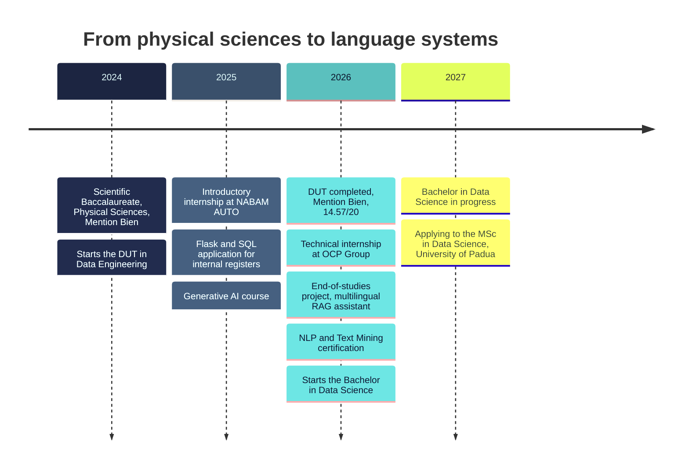
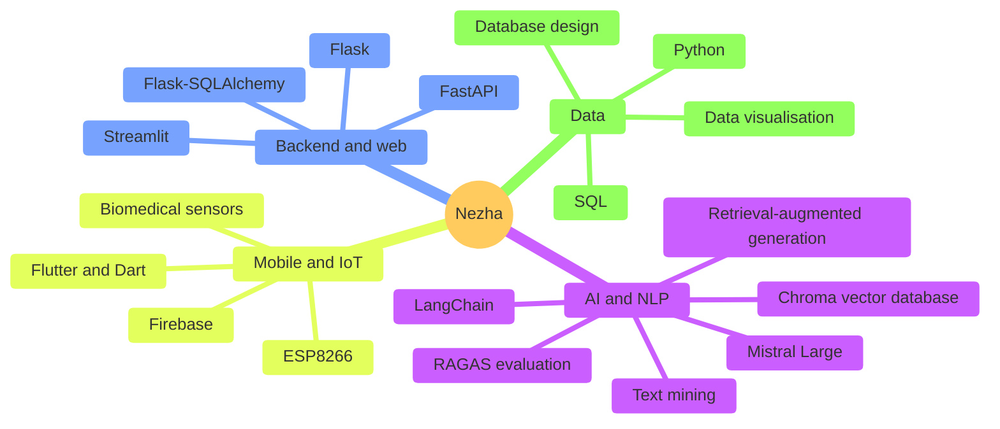

  

[LinkedIn](https://linkedin.com/in/nezha-en-naji-el-idrissi-097a01364) &nbsp;|&nbsp; [Email](mailto:n.ennajielidrissi@gmail.com) &nbsp;|&nbsp; Morocco, El Kelaa des Sraghna

---

## Profile

I am a Data Science student with a **DUT in Data Engineering** (Mention Bien, 14.57/20), and I work where data meets language. My strongest work is a **multilingual retrieval-augmented generation system** built during my end-of-studies internship at OCP Group, which answers IT support questions in French, English and Arabic and was evaluated quantitatively rather than judged by feel.

Before that, I built a full IoT health-monitoring platform (hardware, mobile app, cloud) and a SQL-backed internal web application for an automotive dealership. I like owning a system from the raw signal to the user interface, and I care about measuring whether it actually works.

**I am applying to the MSc in Data Science at the University of Padua (2027/2028).**

---

## At a glance

| | |
|---|---|
| **Focus** | NLP, retrieval-augmented generation, data engineering |
| **Education** | Bachelor in Data Science (2026-2027), DUT in Data Engineering (2024-2026) |
| **Industry experience** | OCP Group (2026), NABAM AUTO, Peugeot Citroen (2025-2026) |
| **Languages** | Arabic (native), French, English, Italian (learning) |
| **Looking for** | Internships and collaborations in NLP, RAG and data-driven applications |

---

## Flagship project: multilingual RAG assistant

A question in French, English or Arabic goes in; a grounded answer comes out, built only from the retrieved knowledge base.

| | |
|---|---|
| **Stack** | Python, LangChain, Chroma, Mistral Large, FastAPI, Streamlit |
| **Scale** | 3,384+ indexed chunks |
| **Quality** | RAGAS scores approx. 0.81 to 0.83 |
| **Languages** | French, English, Arabic |
| **Code** | [github.com/NezhaIdrissi/chatbot-it-rag](https://github.com/NezhaIdrissi/chatbot-it-rag) |

---

## Project: SmartHealth, an IoT health platform from sensor to screen

A team project covering hardware, cloud and mobile: vital signs are measured on a microcontroller, stored in the cloud and shown in real time with alerts.

---

## Project: internal process digitalisation at NABAM AUTO

A register-management web application for a Peugeot Citroen dealership, built with Flask and a SQL database.

---

## Path

---

## Technical map

| Domain | Tools |
|---|---|
| **AI and NLP** | LangChain, Chroma, Mistral Large, RAG, RAGAS |
| **Backend and web** | FastAPI, Flask, Flask-SQLAlchemy, Flask-Login, Flask-WTF, Streamlit |
| **Mobile and IoT** | Flutter, Dart, Firebase, ESP8266, MAX30102, MLX90614 |
| **Data** | Python, SQL, database design, data visualisation |

---

## Education and certifications

| Period | Qualification |
|---|---|
| 2026 - 2027 |
