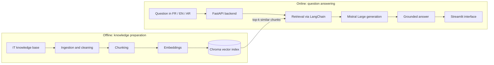
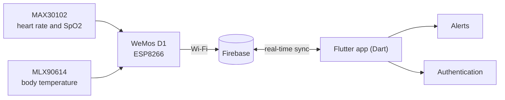
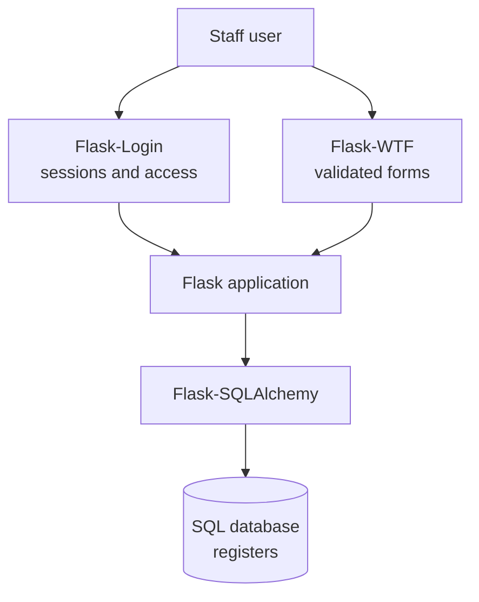

<!--
  MAINTENANCE NOTES (invisible on GitHub). Items marked VERIFY could not be checked
  against the repositories and must be confirmed before publishing.
-->

**Data Science Student | NLP & Retrieval-Augmented Generation | Data Engineering**

I build data and language systems end to end, from data preparation to deployment and evaluation.

[LinkedIn](https://linkedin.com/in/nezha-en-naji-el-idrissi-097a01364) &nbsp;·&nbsp; [Email](mailto:n.ennajielidrissi@gmail.com) &nbsp;·&nbsp; El Kelaa des Sraghna, Morocco

---

## About

I hold a **DUT in Data Engineering** (2024–2026, *Mention Bien*, 14.57/20) and I am currently pursuing a **Bachelor in Data Science** (2026–2027). My work sits at the intersection of data engineering, machine learning and language technologies.

My main project is a **multilingual Retrieval-Augmented Generation (RAG) assistant** for IT support questions in French, English and Arabic, developed during my internship at OCP Group and evaluated with quantitative metrics. Alongside it, I have built an IoT health-monitoring platform (as part of a team) and a Flask web application for internal process management.

I like to follow a system from raw data to a usable interface, and to measure whether it actually works.

| | |
|---|---|
| **Focus** | NLP, Information Retrieval, RAG, data engineering |
| **Education** | Bachelor in Data Science (2026–2027) · DUT in Data Engineering (2024–2026) |
| **Experience** | OCP Group internship (2026) · NABAM AUTO |
| **Languages** | Arabic (native) · French · English · Italian (learning) |
| **Open to** | Internships, academic collaborations and technical projects in Data Science and NLP |

---

## Academic direction

My path started with a Scientific Baccalaureate in Physical Sciences, continued with a DUT in Data Engineering, and now with a Bachelor in Data Science. Across these stages my interests have moved from data pipelines and databases toward NLP, information retrieval and applied AI.

My academic objective is to pursue an **MSc in Data Science at the University of Padua** starting in the 2027/2028 academic year.

<!-- VERIFY: confirm this objective is still accurate. Do not change to "applying/admitted" unless true. -->

---

## Featured project: Multilingual RAG Assistant

**Repository:** [NezhaIdrissi/chatbot-it-rag](https://github.com/NezhaIdrissi/chatbot-it-rag)

### Problem and objective

IT support knowledge is often scattered across documents, and users ask questions in different languages. The goal was an assistant that answers in **French, English and Arabic**, using only the content of a knowledge base, so that answers can be traced back to retrieved passages instead of relying on the model's general memory.

### Architecture

### How it works

| Stage | Description |
|---|---|
| **Ingestion and preprocessing** | Knowledge-base documents are loaded and cleaned. |
| **Chunking** | Documents are split into passages, producing **3,384+ indexed chunks**. <!-- VERIFY: figure, chunk size and overlap --> |
| **Embeddings and indexing** | Chunks are embedded and stored in a Chroma vector index. <!-- VERIFY: embedding model name --> |
| **Retrieval** | The question is matched against the index and the most similar chunks are returned. <!-- VERIFY: top-k value --> |
| **Generation** | Mistral Large answers from the retrieved context. |
| **Serving** | A FastAPI backend exposes the pipeline; a Streamlit interface lets users ask questions. |

### Evaluation

The system was evaluated with **RAGAS**, with reported scores between approximately **0.81 and 0.83**.

<!-- VERIFY: replace with a table of exact RAGAS metric names, one score per metric
     (e.g. faithfulness, answer relevancy, context precision/recall), plus the size
     and language split of the test set. Never present them as one combined score. -->

### Why it matters technically

- **Multilingual retrieval** requires embeddings and an index that place questions and documents in a shared semantic space, so a question in one language can match content written in another.
- **Grounded generation** constrains the language model to retrieved evidence, which reduces unsupported answers and makes them easier to audit.
- **Systematic evaluation** replaces subjective impressions with measurable criteria.

### Possible next steps (not implemented)

- Report evaluation results separately for each language.
- Compare retrieval strategies and embedding models.
- Extend the test set and document failure cases.

<!-- VERIFY: replace with real limitations documented in the repository. -->

---

## SmartHealth: IoT health monitoring platform

A **team project** covering hardware, cloud and mobile development: vital signs are measured by sensors, sent over Wi-Fi, stored in the cloud and displayed in real time with alerts.

**Stack:** MAX30102, MLX90614, WeMos D1 (ESP8266), Firebase, Flutter, Dart.

<!-- VERIFY: state precisely which parts were Nezha's own contribution (e.g. firmware, Firebase, app screens). Also confirm which Firebase services are used (Realtime Database, Firestore, Auth). -->

---

## NABAM AUTO: internal process digitalisation

**Problem:** internal registers at a car dealership needed a structured, controlled way of being recorded and consulted.
**Solution:** a Flask web application backed by a SQL database, with validated forms and role-based access.

**Stack:** Flask, Flask-SQLAlchemy, Flask-Login, Flask-WTF, SQL.

<!-- VERIFY: dates (the previous README gave two different periods), the company name wording, and the exact registers handled. No performance or business-impact figures should be added unless documented. -->

---

## Technical expertise

| Domain | Technologies |
|---|---|
| **AI, NLP & Information Retrieval** | Retrieval-Augmented Generation · LangChain · Chroma · Mistral · RAGAS · Text Mining |
| **Data Engineering & Databases** | Python · SQL · Database Design · Data Processing |
| **Backend & Application Development** | FastAPI · Flask · Flask-SQLAlchemy · Streamlit |
| **Mobile & IoT** | Flutter · Dart · Firebase · ESP8266 · MAX30102 · MLX90614 |

---

## Timeline

| Period | Milestone |
|---|---|
| 2024 | Scientific Baccalaureate, Physical Sciences <!-- VERIFY: mention/grade before adding --> |
| 2024–2026 | DUT in Data Engineering: *Mention Bien*, 14.57/20 |
| 2025 | NABAM AUTO: Flask and SQL application for internal registers <!-- VERIFY: dates --> |
| 2026 | OCP Group internship: multilingual RAG assistant |
| 2026–2027 | Bachelor in Data Science (in progress) |
| 2027/2028 | Academic objective: MSc in Data Science, University of Padua |

---

## Education and certifications

### Education

| Period | Qualification | Institution |
|---|---|---|
| 2026–2027 | Bachelor in Data Science | <!-- VERIFY: institution --> |
| 2024–2026 | DUT in Data Engineering, *Mention Bien* (14.57/20) | <!-- VERIFY: institution --> |
| 2024 | Scientific Baccalaureate, Physical Sciences | <!-- VERIFY: school --> |

### Certifications

| Certification | Issuer | Verification |
|---|---|---|
| NLP and Text Mining | <!-- VERIFY --> | <!-- VERIFY: real link only --> |
| Generative AI course | <!-- VERIFY --> | <!-- VERIFY: real link only --> |

---

## Research interests

These are areas I want to study and work on, not completed research.

- Multilingual NLP
- Semantic search and information retrieval
- Retrieval-Augmented Generation
- Evaluation of LLM-based systems
- Data engineering for AI applications
- Applied machine learning

---

## Contact

I am open to academic collaborations, internships and technical projects in Data Science and NLP.

- **LinkedIn:** [nezha-en-naji-el-idrissi](https://linkedin.com/in/nezha-en-naji-el-idrissi-097a01364)
- **Email:** [n.ennajielidrissi@gmail.com](mailto:n.ennajielidrissi@gmail.com)
- **GitHub:** [NezhaIdrissi](https://github.com/NezhaIdrissi)
